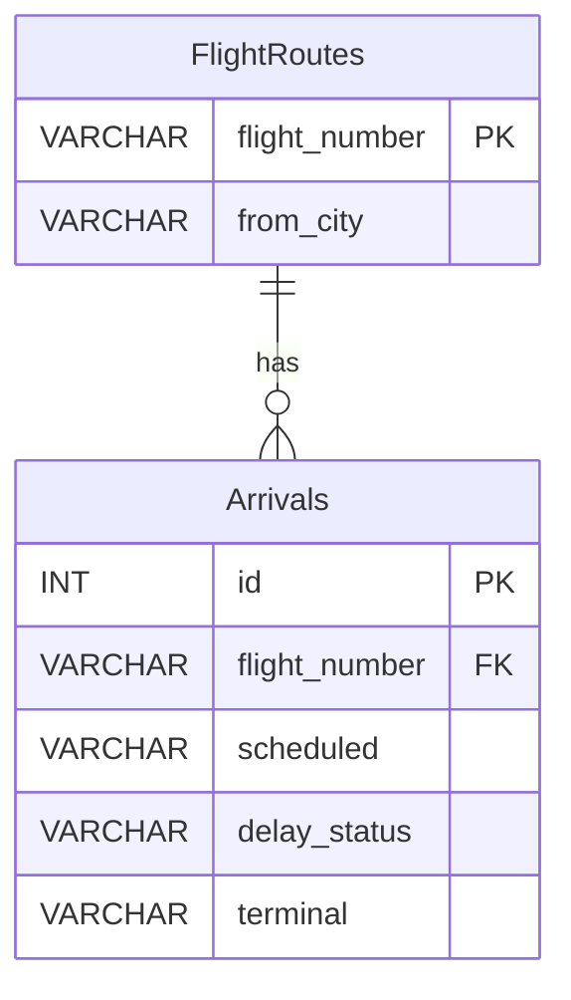

# JDBC Flight Manager

## 1. Project Description
A Java application for managing airport flight arrivals using
MySQL and JDBC. The project demonstrates database normalization,
batch processing, SQL queries, and SQL Injection prevention.

## 2. Engineering Team Details
- Student A: GAITH MOSTAFA
- Student B: AMIR SANALLAH
- Student c: Kossai habiballah
- Group Number: [Group Number]
- Course: Software Engineering Methods

## 3. Technology Stack
- Java 25 (BellSoft Liberica)
- IntelliJ IDEA Ultimate
- MySQL 8.0+
- MySQL Connector/J 9.5.0
- Git and GitHub
- Continue AI
- LM Studio (Qwen2.5-Coder-7B-Instruct)

## 4. Database Normalization (3NF)
The original rawflights table contained:
scheduled, flight, fromC, delay, terminal.

Functional dependency:
flight -> fromC

To eliminate redundancy, the database was divided into:

FlightRoutes:
- flight_number (Primary Key)
- from_city

Arrivals:
- id (Primary Key)
- flight_number (Foreign Key)
- scheduled
- delay_status
- terminal

## 5. Independent AI Prompt
[Paste your exact Part 4 English prompt here.]

## 6. Entity Relationship Diagram

## 7. Security Audit Summary
The original SimpleFlightUpdater used Statement with
string concatenation, making it vulnerable to SQL Injection.

The attack payload Landed' # caused the WHERE clause
to be ignored, potentially updating all 299 records.

The vulnerability was fixed using PreparedStatement
with parameterized SQL queries.

After the fix, the same payload is treated as literal
data and updates only the targeted flight.

## 8. License
Educational project developed for Software Engineering
Methods at Braude College of Engineering.
