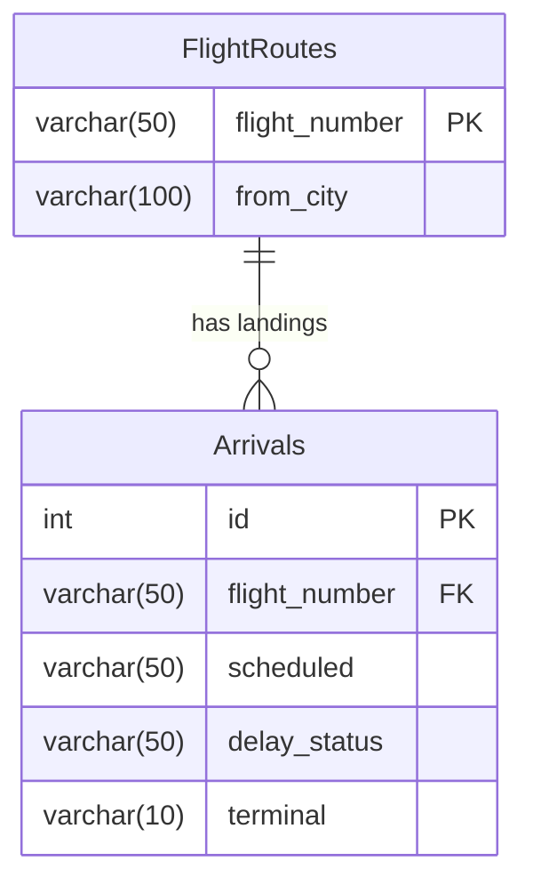

# Flight Arrivals Management System (`JDBC_FlightManager`)

**Course:** Software Engineering Methods (Academic Year 2026–2027)  
**Institution:** Braude College of Engineering | Department of Software Engineering  
**Database Engine:** MySQL 8.0+ | **Language:** Java 25 LTS (JDBC)

---

## 1. Project Description
[Provide a concise overview of the Flight Arrivals Data Access Layer (DAL), CSV ingestion, 3NF relational schema, JDBC operations, and SQL Injection remediation.]

---

## 2. Engineering Team Details (Single-Workstation Driver–Navigator)

| Role | Full Name | Student ID | Braude Academic Email |
| :--- | :--- | :--- | :--- |
| **Student A** | `[Enter Student A Full Name]` | `[Enter ID]` | `[studentA@e.braude.ac.il]` |
| **Student B** | `[Enter Student B Full Name]` | `[Enter ID]` | `[studentB@e.braude.ac.il]` |

* **Group Number:** `G[XX]`
* **GitHub Repository URL:** `https://github.com/[Username]/JDBC_FlightManager`

---

## 3. Technology Stack
* **Runtime & JDK:** BellSoft Liberica Full JDK 25 LTS
* **Database Server:** MySQL Server 8.0+ (`FlightDB` schema)
* **JDBC Driver:** MySQL Connector/J 9.5.0 (`mysql-connector-j-9.5.0.jar`)
* **IDE & Database Tooling:** IntelliJ IDEA Ultimate (Built-in Database Console & SQL Generator)
* **Local AI Assistant:** LM Studio (`Qwen2.5-Coder-7B-Instruct`) integrated via the Continue plugin
* **Version Control:** Git & GitHub

---

## 4. Database Normalization (3NF) & Functional Dependencies ($F$)

### 4.1 Functional Dependencies ($F$) in `rawflights`
[Document the functional dependencies identified in `rawflights(scheduled, flight, fromC, delay, terminal)`, including $\text{flight} \rightarrow \text{fromC}$.]

### 4.2 Why `rawflights` Violated 3NF
[Explain transitive redundancy and the update, insertion, and deletion anomalies resolved by decomposition.]

### 4.3 Decomposed 3NF Relational Schema
[List the tables (`FlightRoutes` and `Arrivals`), their columns, Primary Keys, and Foreign Key constraints.]

---

## 5. Independent AI Prompt (Part 4 – `FlightViewer.java`)

```text
[Paste here the exact English prompt you authored in Continue to generate FlightViewer.java]
```

---

## 6. Entity Relationship Diagram (ERD)



---

## 7. Security Audit Summary (Part 5 – SQL Injection Mitigation)
* **Attack Payload Tested:** `Landed' #`
* **Vulnerability Analysis (`Statement`):** [Explain how string concatenation allowed the payload to bypass the WHERE clause and corrupt all 299 rows.]
* **Remediation (`PreparedStatement`):** [Explain how parameterized queries and pre-compilation neutralized the exploit.]

---

## 8. License
Distributed under the **Braude College Academic License** (Software Engineering Methods, 2026–2027).